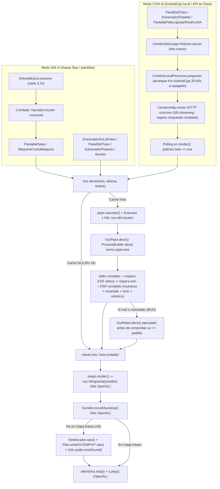

# Informe de Investigación Técnica: Latencia de las Voces en MetajavBots

> **Alcance:** Investigación y diagnóstico en profundidad sobre el código fuente actual (**sin modificar código de producción ni recursos**).  
> **Contexto:** Escritorio Windows / LWJGL3 (libGDX `1.14.2`, Java 17), funcionamiento tanto **sin IA** como **con cerebros de IA locales/en línea**, y consideración explícita de desacoplamiento para un **futuro port a web**.

---

## 1. Resumen ejecutivo

El retraso perceptible entre que ocurre un evento (o aparece un texto en pantalla) y el momento en que empieza a sonar la voz se debe a una **acumulación de bloqueos secuenciales** en el pipeline actual:

1. **En modo SIN IA (diálogos fijos y plantillas):**
   - El cuello de botella dominante es que [`VozPiper.decir()`](../juego/src/main/java/metajavbots/sonido/VozPiper.java#L84-L115) **arranca un proceso `piper.exe` nuevo desde cero en cada frase no cacheada**, pagando en cada intervención la creación del proceso en Windows, carga de DLLs nativas, inicialización de ONNX Runtime y lectura completa del modelo `.onnx` (~60–75 MB para voces `medium`) antes de sintetizar el primer fonema.
   - Además, el pipeline **no hace streaming**: espera a sintetizar el texto entero, procesa todo el buffer PCM en bloque, serializa un `.wav` completo a disco en `%TEMP%` y lo recarga con `Gdx.audio.newSound(...)` **en el hilo principal de renderizado** ([`Sonidos.java`](../juego/src/main/java/metajavbots/sonido/Sonidos.java#L44-L58)).
   - Se detectaron **errores de concurrencia/cancelación** en [`Voz.java`](../juego/src/main/java/metajavbots/sonido/Voz.java#L62-L81) que agravan la latencia cuando se encadenan frases (p. ej. `EntradaEpica` o clics rápidos en el tutor): al cancelar Piper, el hilo único de voz ejecuta innecesariamente el fallback `VozRobot` sobre la frase ya descartada antes de empezar la nueva.

2. **En modo CON IA (cerebros locales con KoboldCpp o en línea):**
   - A todo lo anterior se suma una **espera totalmente serializada del LLM sin streaming** ([`CerebroHttp.java`](../juego/src/main/java/metajavbots/cerebro/CerebroHttp.java#L164-L171)): la voz ni siquiera empieza a sintetizarse hasta que el LLM ha generado el último token de la respuesta (11–30 s en local según [`docs/CEREBRO.md`](../docs/CEREBRO.md#L31-L35), o 20–50 s adicionales si KoboldCpp arranca en frío).
   - En combate, [`PantallaPelea.pedirPullas()`](../juego/src/main/java/metajavbots/pantallas/PantallaPelea.java#L240-L259) dispara **3 hilos concurrentes** contra KoboldCpp al inicio de cada ronda justo cuando Piper necesita CPU para el locutor, creando contención directa en procesadores de 4 núcleos (como el i7-1065G7 documentado en `docs/CEREBRO.md`).

**Solución recomendada:** Adoptar una arquitectura desacoplada por interfaz (`MotorDeVoz` inyectado desde `lwjgl3`, equivalente al patrón existente `SelectorDeArchivos`), implementada en dos fases principales:
- **Fase 1 (beneficia a ambos modos):** Proceso **persistente** de `piper.exe` por idioma activo + **segmentación por oraciones** + reproducción PCM directa en memoria mediante `AudioDevice` de libGDX (eliminando escritura/lectura `.wav` en disco y bloqueo del hilo GL) + corrección de los bugs de cancelación y mejora de caché.
- **Fase 2 (transforma el modo con IA):** Streaming SSE (`"stream": true`) en `CerebroHttp` conectado oración-a-oración a la cola de voz + reducción de concurrencia en `pedirPullas`.

---

## 2. Mapa completo del flujo de voz actual

### 2.1 Diagrama del flujo actual (End-to-End)

### 2.2 Inventario completo de disparadores de voz

| Origen | Modo | Archivo y líneas | Qué dispara la voz | Timbre |
|---|---|---|---|---|
| Locutor en pelea (sucesos, rondas, final) | Sin IA | [`Narrador.java`](../juego/src/main/java/metajavbots/dialogos/Narrador.java#L79-L91) → [`PantallaPelea.java`](../juego/src/main/java/metajavbots/pantallas/PantallaPelea.java#L140-L144) | `narrador.alHablarLocutor` llama `j.voz.decir(f, jug.idioma)` | `Timbre.LOCUTOR` |
| Presentación épica de combatientes | Sin IA | [`EntradaEpica.java`](../juego/src/main/java/metajavbots/pantallas/EntradaEpica.java#L51-L62) | `narrador.anunciar(...)` cada `3.2 s` y `"entrada.a_pelear"` (`1.0 s`) | `Timbre.LOCUTOR` |
| Locutor en Máquina vs Máquina | Sin IA | [`MaquinaContraMaquina.java`](../juego/src/main/java/metajavbots/pantallas/MaquinaContraMaquina.java#L79-L83) | `narrador.alHablarLocutor` → `j.voz.decir(f, j.jugador.idioma)` | `Timbre.LOCUTOR` |
| Resumen del locutor entre rondas | **Con IA** | [`PantallaPelea.java`](../juego/src/main/java/metajavbots/pantallas/PantallaPelea.java#L185-L191) y [`L218-L236`](../juego/src/main/java/metajavbots/pantallas/PantallaPelea.java#L218-L236) | Hilo `ajustar-rival` pide estilo + frase; se dice al empezar la ronda siguiente | `Timbre.LOCUTOR` |
| Entrenador en la pelea (milagro, consejos) | Sin IA | [`EntrenadorEnLaPelea.java`](../juego/src/main/java/metajavbots/pantallas/EntrenadorEnLaPelea.java#L64), [`L146`](../juego/src/main/java/metajavbots/pantallas/EntrenadorEnLaPelea.java#L146), [`L184`](../juego/src/main/java/metajavbots/pantallas/EntrenadorEnLaPelea.java#L184) | Al ganar a jefe, al detectar patrón del rival marcado o pulsar «Otro» | `en.timbre` |
| Panel del Tutor en el Taller | Sin IA y **Con IA** | [`PanelDelTutor.java`](../juego/src/main/java/metajavbots/pantallas/PanelDelTutor.java#L39-L43), [`L171-L196`](../juego/src/main/java/metajavbots/pantallas/PanelDelTutor.java#L171-L196) | Saludo, metas, pistas o respuesta completa de `CerebroDelJuego.Peticion` (`110` palabras) | `Entrenador.timbre` |
| Entrenador Flotante (F2) | Sin IA y **Con IA** | [`EntrenadorFlotante.java`](../juego/src/main/java/metajavbots/pantallas/EntrenadorFlotante.java#L229-L232), [`L640-L647`](../juego/src/main/java/metajavbots/pantallas/EntrenadorFlotante.java#L640-L647), [`L690-L691`](../juego/src/main/java/metajavbots/pantallas/EntrenadorFlotante.java#L690-L691), [`L708-L730`](../juego/src/main/java/metajavbots/pantallas/EntrenadorFlotante.java#L708-L730) | Tips automáticos, pasos de error, botón «Leer» (párrafos enteros) o respuesta IA (`280` palabras) | `Entrenador.timbre` |
| Botón «Probar voz» en Ajustes | Sin IA | [`Ajustes.java`](../juego/src/main/java/metajavbots/pantallas/Ajustes.java#L103-L105) | Prueba manual de frase `inicio_pelea` | `Timbre.LOCUTOR` |

*(Nota: los bocadillos de los robots en pelea vía `narrador.alHablarRobot` solo llaman a `vista.decir(q, f)` y no invocan `Voz`.)*

### 2.3 Ciclo de vida, configuración y reproducción

- **Instanciación y configuración:** [`Juego.java`](../juego/src/main/java/metajavbots/Juego.java#L35) crea `Voz` como campo directo; [`Juego.ponerJugador()`](../juego/src/main/java/metajavbots/Juego.java#L129-L132) configura `activa`, `clara`, `volumen` y llama a `voz.usarPiper(CerebroLocal.carpeta(j.carpetaModelos).resolve("piper"))`.
- **Bucle principal:** [`Juego.render()`](../juego/src/main/java/metajavbots/Juego.java#L188) ejecuta `voz.fotograma(sonidos)` al final de cada fotograma (60 FPS configurados en [`Main.java`](../lwjgl3/src/main/java/metajavbots/escritorio/Main.java#L21), audio OpenAL configurado con `setAudioConfig(32, 2048, 9)` en [`Main.java`](../lwjgl3/src/main/java/metajavbots/escritorio/Main.java#L24)).
- **Cierre:** [`Juego.dispose()`](../juego/src/main/java/metajavbots/Juego.java#L207-L209) llama a `CerebroLocal.cerrar()`, `voz.liberar()` y `sonidos.liberar()`.

---

## 3. Diagnóstico de cuellos de botella reales (ordenados por impacto estimado)

### 3.1 Escenario A: Modo SIN IA (diálogos fijos y plantillas)

| Prioridad | Causa raíz | Archivo y líneas exactas | Mecanismo del retraso | Impacto estimado (requiere medición) |
|---|---|---|---|---|
| **1 (Crítico)** | **Arranque en frío de `piper.exe` + carga completa del modelo `.onnx` en cada frase** | [`VozPiper.java`](../juego/src/main/java/metajavbots/sonido/VozPiper.java#L89-L91) | Cada llamada a `decir()` ejecuta `new ProcessBuilder(exe, "--model", voz, ...).start()`. Windows crea un nuevo proceso, carga `onnxruntime.dll`/`espeak-ng`, deserializa el archivo `.onnx` completo (~60–75 MB para voces `medium` como `davefx`/`thorsten`/`joe`) e inicializa el grafo ONNX antes de empezar a inferir. | **Alto** (típicamente 0,5–2,0 s por frase antes siquiera de sintetizar; empeora si el archivo está en OneDrive/disco lento o bajo análisis de Windows Defender). |
| **2 (Alto)** | **Síntesis bloqueante del texto completo sin streaming ni segmentación** | [`VozPiper.java`](../juego/src/main/java/metajavbots/sonido/VozPiper.java#L93-L103) | Se envía todo el texto por `stdin`, se cierra y se bloquea en `salida.transferTo(bytes)` hasta que Piper genera la última muestra y termina el proceso (`p.waitFor(20_000)`). En textos largos (botón «Leer» en [`EntrenadorFlotante.java`](../juego/src/main/java/metajavbots/pantallas/EntrenadorFlotante.java#L691) o consejos largos), el jugador espera la síntesis entera del párrafo antes de oír la primera palabra. Si supera `20 s`, falla y cae a `VozRobot`. | **Medio-Alto** (proporcional a la longitud: ~0,2–0,6 s en frases cortas, 2–8+ s en explicaciones largas). |
| **3 (Medio-Alto)** | **Bug de cancelación: fallback innecesario a `VozRobot` en el hilo único de voz** | [`Voz.java`](../juego/src/main/java/metajavbots/sonido/Voz.java#L69-L77) | Cuando llega una frase nueva `B`, `decir()` hace `actual.cancelar()` (`destroyForcibly`) sobre el `piper.exe` de la frase `A`. En el hilo único `"voz-del-locutor"`, `p.decir()` devuelve `null` para `A`. **Antes** de comprobar `if (yo == pedida)` (L77), la línea **L75 ejecuta `VozRobot.decir(A)`** y lo guarda en caché (L76). Eso bloquea el hilo único sintetizando una frase ya cancelada antes de poder atender `B`. | **Medio** en ráfagas rápidas (`EntradaEpica` cada 3,2 s, clics repetidos en «Otro» o «◄/►» en el tutor). Además, [`VozRobot.java`](../juego/src/main/java/metajavbots/sonido/VozRobot.java#L351-L353) recalcula `Math.exp` y `Math.cos` en **cada muestra** (3 resonadores × 22.050 Hz = 66.150 llamadas/s de audio). |
| **4 (Medio)** | **Serialización WAV + escritura a disco + recarga OpenAL en el hilo de render** | [`Voz.java`](../juego/src/main/java/metajavbots/sonido/Voz.java#L85-L91) y [`Sonidos.java`](../juego/src/main/java/metajavbots/sonido/Sonidos.java#L44-L58), [`L79-L105`](../juego/src/main/java/metajavbots/sonido/Sonidos.java#L79-L105) | Cuando la síntesis acaba, el hilo de render (`Juego.render()`) convierte `float[]` a WAV (`Sintetizador.wav()` con `Math.tanh` por muestra), ejecuta `Files.write(f, ...)` en `%TEMP%` y luego `Gdx.audio.newSound(Gdx.files.absolute(...))` que vuelve a leer el archivo de disco y lo sube a OpenAL. Introduce latencia adicional, tirones de fotograma (stuttering) y posible retención temporal por antivirus en Windows. | **Bajo-Medio** (10–80 ms en SSD, picos >150 ms con Windows Defender o frases largas; además congela el frame de render). |
| **5 (Bajo-Medio)** | **Postprocesado DSP secuencial en bloque sobre todo el array** | [`VozPiper.java`](../juego/src/main/java/metajavbots/sonido/VozPiper.java#L106), [`L131-L174`](../juego/src/main/java/metajavbots/sonido/VozPiper.java#L131-L174); [`Timbre.java`](../juego/src/main/java/metajavbots/sonido/Timbre.java#L35-L38) | Cuatro pasadas completas sobre el audio en memoria: `muestras()` (byte→float) → `aFrecuenciaDelJuego()` → `Timbre.cambiarTono()` (si `tono != 1`, que aplica a **todos** los entrenadores de [`res/datos/entrenadores.txt`](../res/datos/entrenadores.txt#L15-L60)) → `robotico()` (2 pasadas con `Math.sin` + `Math.tanh`). En frases largas genera presión de GC y retraso antes de entregar el audio. | **Bajo** en frases cortas (<15 ms), **Bajo-Medio** en párrafos largos (30–100 ms). |
| **6 (Bajo-Medio)** | **Caché pequeña, volátil y sin cancelación en cache hit** | [`Voz.java`](../juego/src/main/java/metajavbots/sonido/Voz.java#L23-L30), [`L61-L70`](../juego/src/main/java/metajavbots/sonido/Voz.java#L61-L70) | `MAX_CACHE = 24` se evicta rápido durante una partida y se pierde al cerrar el juego. Además, si hay *cache hit* (L63-67), **no se llama a `actual.cancelar()`** (L70), dejando el `piper.exe` anterior consumiendo CPU hasta terminar. | **Bajo-Medio** (pérdida de aciertos de caché en frases fijas y desperdicio de CPU en cortes). |
| **7 (UX / Percepción)** | **Desfase entre temporización de UI y latencia real de voz + cortes tardíos** | [`EntradaEpica.java`](../juego/src/main/java/metajavbots/pantallas/EntradaEpica.java#L24), [`L50-L62`](../juego/src/main/java/metajavbots/pantallas/EntradaEpica.java#L50-L62); [`Sonidos.java`](../juego/src/main/java/metajavbots/sonido/Sonidos.java#L102); [`Juego.java`](../juego/src/main/java/metajavbots/Juego.java#L79-L110) | `EntradaEpica` da `3,2 s` por robot y `1,0 s` para `"¡A pelear!"`: si Piper tarda 1,5–2 s en empezar, la frase se corta a mitad cuando entra el siguiente robot. Además, la voz anterior **no se silencia al pedir una nueva** ni al cambiar de pantalla (`ir`/`irSolo`/`volver`) o cerrar el entrenador flotante: solo se corta cuando la nueva frase termina de sintetizarse (`ultimaVoz.stop()`). | **Alto en percepción de usuario** (sensación de audio atrasado y atropellado). |

*(Nota menor de concurrencia detectada: en [`Voz.java`](../juego/src/main/java/metajavbots/sonido/Voz.java#L64-L65) y [`L78-L79`](../juego/src/main/java/metajavbots/sonido/Voz.java#L78-L79) se escribe `claveLista` y luego `lista`, pero en [`Voz.fotograma()`](../juego/src/main/java/metajavbots/sonido/Voz.java#L86-L87) se lee `lista` antes que `claveLista`, lo que puede emparejar muestras con una clave de otra frase si coinciden dos actualizaciones.)*

---

### 3.2 Escenario B: Modo CON IA (cerebros locales KoboldCpp y en línea)

En modo con IA se suman **todos los cuellos de botella del Escenario A** más los siguientes, que dominan el tiempo total hasta la primera palabra hablada (*Time-To-First-Audio*, TTFA):

| Prioridad | Causa raíz | Archivo y líneas exactas | Mecanismo del retraso | Impacto estimado |
|---|---|---|---|---|
| **1 (Crítico)** | **Espera de la respuesta completa del LLM sin streaming** | [`CerebroHttp.java`](../juego/src/main/java/metajavbots/cerebro/CerebroHttp.java#L47-L64), [`L128-L171`](../juego/src/main/java/metajavbots/cerebro/CerebroHttp.java#L128-L171); [`PanelDelTutor.java`](../juego/src/main/java/metajavbots/pantallas/PanelDelTutor.java#L188-L196); [`EntrenadorFlotante.java`](../juego/src/main/java/metajavbots/pantallas/EntrenadorFlotante.java#L643-L647), [`L728`](../juego/src/main/java/metajavbots/pantallas/EntrenadorFlotante.java#L728) | Todas las peticiones usan `HttpClient.send(..., BodyHandlers.ofString())` sin `"stream": true`. El tutor pide hasta `110` palabras (`198` tokens) y el entrenador flotante hasta `280` palabras (`504` tokens). Solo cuando el LLM cierra la respuesta completa se llama a `decir(j, respuesta)` y **entonces** empieza Piper. | **Muy Alto:** según [`docs/CEREBRO.md`](../docs/CEREBRO.md#L33-L35), **11–16 s** con Gemma 3 4B y **25–30 s** con Qwen3.5-9B solo en el LLM, más la síntesis completa de Piper después. |
| **2 (Crítico en frío)** | **Arranque perezoso en frío de `koboldcpp.exe` + fallback GPU→CPU** | [`CerebroLocalPerezoso.java`](../juego/src/main/java/metajavbots/cerebro/CerebroLocalPerezoso.java#L18), [`L57-L64`](../juego/src/main/java/metajavbots/cerebro/CerebroLocalPerezoso.java#L57-L64); [`CerebroLocal.java`](../juego/src/main/java/metajavbots/cerebro/CerebroLocal.java#L247-L290) | La primera pregunta (o tras 8 min de inactividad) arranca KoboldCpp y hace polling cada `1.500 ms` (`esperarACargar`, L279). Si un segundo modelo no cabe en VRAM (Vulkan), primero prueba `enLaGrafica = true`, falla y luego reintenta en CPU (`L256-L264`). | **Muy Alto en primer uso:** **20–50 s** (documentado en `docs/CEREBRO.md` L33-35), y hasta el doble si falla Vulkan y reintenta en CPU. |
| **3 (Alto)** | **Contención de CPU y cola en KoboldCpp por peticiones simultáneas en pelea** | [`PantallaPelea.java`](../juego/src/main/java/metajavbots/pantallas/PantallaPelea.java#L184), [`L240-L259`](../juego/src/main/java/metajavbots/pantallas/PantallaPelea.java#L240-L259); [`L199-L237`](../juego/src/main/java/metajavbots/pantallas/PantallaPelea.java#L199-L237) | Al empezar cada ronda, `pedirPullas()` lanza **3 hilos simultáneos** contra el mismo KoboldCpp local mientras el locutor dispara `piper.exe` en el mismo instante. En un portátil de 4 núcleos (`i7-1065G7`), KoboldCpp y ONNX Runtime (Piper) compiten por la misma CPU. Además, entre rondas, `ajustarRivalConIA()` encadena **dos llamadas secuenciales** (estilo + locutor) en el mismo hilo `ajustar-rival` (L221 y L229); si el jugador pulsa «Siguiente ronda» antes de ~20 s, `resumenDelLocutor` aún es `null` y no suena en esa ronda. | **Alto** en combate con IA local (ralentiza tanto Piper como la llegada de frases de la IA). |
| **4 (Medio)** | **Doble llamada en fallback OpenAI → KoboldCpp** | [`CerebroHttp.java`](../juego/src/main/java/metajavbots/cerebro/CerebroHttp.java#L54-L61) | Si `/v1/chat/completions` devuelve texto vacío (p. ej. si el modelo ignora `enable_thinking: false` y gasta los tokens pensando) o lanza error, reintenta la petición entera contra `/api/v1/generate`, duplicando el tiempo de espera. | **Medio-Alto** cuando ocurre (duplica la latencia del LLM). |

---

## 4. Comparativa objetiva de soluciones viables

Se evalúan cinco alternativas técnicas aplicables a este repositorio concreto:

| Criterio | **A. Piper persistente + `AudioDevice` en memoria + chunking por oración + SSE en LLM** *(Recomendada)* | **B. ONNX Runtime + `espeak-ng` embebido vía JNI en Java** | **C. Sidecar HTTP local para Piper (Python o wrapper C++)** | **D. Audio `.ogg` pre-generado en build para frases fijas** | **E. Parche mínimo (mantener `ProcessBuilder` por frase + arreglar bugs + `AudioDevice`)** |
|---|---|---|---|---|---|
| **Latencia esperada SIN IA (1.ª vez)** | **~150–400 ms** (0 arranque de proceso; primera oración suena al vuelo) | **~80–250 ms** (in-process) | **~200–450 ms** (overhead HTTP local mínimo) | **< 15 ms** (solo frases fijas sin huecos; no cubre texto dinámico) | **~700–2.200 ms** (sigue arrancando `piper.exe` + 65 MB ONNX en cada frase) |
| **Latencia esperada SIN IA (cacheada)** | **< 15 ms** (en memoria o caché local) | **< 15 ms** | **< 15 ms** | **< 15 ms** | **< 15 ms** |
| **Latencia esperada CON IA (TTFA)** | **~2–6 s** (TTFT + 1.ª oración SSE + síntesis 1.ª oración; reducción del 70–85 %) | **~2–6 s** (si se añade SSE) | **~2–6 s** (si se añade SSE) | No mejora la IA (~15–35 s) | No mejora la IA (~15–35 s) |
| **Complejidad de implementación** | **Media** (bien acotada y divisible en 2 fases) | **Muy Alta** (JNI multiplataforma, `espeak-ng` C++, empaquetado nativo) | **Media-Alta** (requiere distribuir Python o compilar binario C++ propio) | **Media** (pipeline de build + explosión combinatoria: 3 idiomas × 7+ entrenadores × huecos) | **Baja** |
| **Consumo CPU / RAM** | **Bajo-Moderado** (~120–180 MB RAM por proceso Piper del idioma activo; 0 CPU en reposo) | **Bajo** (~100–150 MB RAM dentro del proceso JVM) | **Moderado** (~150–250 MB RAM si usa Python) | **Muy Bajo** en RAM/CPU, pero **muy alto en disco/descarga** (cientos de MB en assets) | **Alto en picos de CPU/I/O** por recarga continua del modelo |
| **Riesgo de procesos huérfanos** | **Bajo-Medio**, mitigable (ShutdownHook + cierre explícito en `dispose()` + Job Object / watchdog de stdin cerrado: Piper sale solo al cerrarse `stdin`) | **Nulo** (sin subprocesos) | **Medio** (servidor HTTP puede quedar vivo si el JVM muere con `SIGKILL` sin watchdog) | **Nulo** | **Bajo** (procesos cortos, aunque `destroyForcibly` ya se usa) |
| **Facilidad de separación futura para Web** | **Muy Alta** si se introduce la interfaz `MotorDeVoz` en `juego` e implementación en `lwjgl3` | **Media** (requiere abstracción igual, pero la inversión JNI no se reutiliza en web) | **Muy Alta** (en web el mismo cliente HTTP puede hablar con un backend TTS) | **Alta** (assets estáticos en web), pero incompleta para textos dinámicos/IA | **Baja** (mantiene acoplamiento a `ProcessBuilder` y `Files` en `juego`) |

---

## 5. Recomendación final y arquitectura propuesta

Se recomienda la **Alternativa A**, ejecutada de forma incremental en **tres fases independientes**, cada una medible y verificable sin romper el funcionamiento sin IA ni el modo con IA.

### 5.1 Principio de diseño para desacoplar Escritorio y futuro Web

Hoy el módulo `juego` contiene directamente código dependiente de escritorio que no es portable a web (GWT/TeaVM): `ProcessBuilder` en [`VozPiper.java`](../juego/src/main/java/metajavbots/sonido/VozPiper.java#L90), `Files.createTempDirectory`/`Files.write` en [`Sonidos.java`](../juego/src/main/java/metajavbots/sonido/Sonidos.java#L34-L51) y `java.net.http.HttpClient` en [`CerebroHttp.java`](../juego/src/main/java/metajavbots/cerebro/CerebroHttp.java#L26).

Siguiendo el mismo patrón de inyección que ya utiliza el proyecto en [`Juego.java`](../juego/src/main/java/metajavbots/Juego.java#L50) y [`Main.java`](../lwjgl3/src/main/java/metajavbots/escritorio/Main.java#L26) (`selectorDeArchivos`), la propuesta es:

1. **En `juego`:** definir una interfaz ligera de síntesis/reproducción de voz (por ejemplo, `SintetizadorDeVoz` o `MotorDeVoz`) que no dependa de `ProcessBuilder` ni de `java.nio.file`, con operaciones claras:
   - `disponible(Idioma)`
   - `hablar(String texto, Idioma idioma, Timbre timbre, long idPeticion)` / envío por oraciones
   - `callar()` (corte inmediato)
   - `liberar()`
   - En `juego` queda `VozRobot` como implementación pura en Java de respaldo (100 % portable) y la lógica de cola/segmentación de oraciones.
2. **En `lwjgl3`:** inyectar la implementación de escritorio (`MotorVozPiper` + reproducción directa vía `Gdx.audio.newAudioDevice(...)`) en `Main.java`.
3. **En un futuro módulo `web`:** bastará con inyectar una implementación basada en **Web Speech API** (`window.speechSynthesis`, latencia casi cero y cero servidor) o un **cliente fetch/WebAudio** contra un endpoint TTS, sin modificar ninguna pantalla ni `Narrador`, `PanelDelTutor` o `EntrenadorFlotante`.

*(Misma recomendación para `Cerebro`: cuando se aborde la Fase 2, añadir un método opcional `preguntarEnFlujo(sistema, conv, maxPalabras, Consumer<String> alTrozo)` en la interfaz [`Cerebro.java`](../juego/src/main/java/metajavbots/cerebro/Cerebro.java#L13) con implementación `default` que delegue en `preguntar(...)`, manteniendo compatibilidad hacia atrás con todos los cerebros y tests existentes.)*

---

### 5.2 Detalle de las fases recomendadas

#### Fase 1 — Eliminación de cuellos de botella en TTS y audio (impacto inmediato en modo SIN IA y CON IA)

1. **Worker persistente de Piper por idioma (`VozPiper` / `MotorVozPiper`):**
   - Mantener **un proceso `piper.exe` vivo** para el idioma activo con `--model <voz.onnx> --json-input` (en lugar de lanzar `ProcessBuilder` por frase).
   - **Pre-calentamiento en segundo plano:** al llamar a `Juego.ponerJugador()` (o al cambiar de idioma en Ajustes), arrancar el proceso en un hilo daemon para que el modelo `.onnx` ya esté en RAM antes de la primera frase.
   - **Protocolo de delimitación seguro:** dado que con `--output_raw` y `--json-input` Piper no inserta delimitadores de fin de frase en `stdout`, existen dos estrategias viables según lo que confirme la prueba del binario instalado (ver §6):
     - *Opción 1a (delimitación exacta sin ambigüedad):* enviar líneas JSON `{"text":"...", "output_file":"<temp>/frase_N.wav"}` por `stdin` y leer la línea de confirmación en `stdout` que Piper imprime al terminar cada oración; leer los bytes PCM del archivo en el hilo worker (nunca en el hilo de render) y borrarlo inmediatamente.
     - *Opción 1b (cero disco, streaming puro):* usar `--output_raw` sin `--json-input` (línea por línea de texto plano en `stdin`) consumiendo chunks de `stdout` hacia `AudioDevice`, sabiendo que en caso de corte brusco (`barge-in`) a mitad de una frase larga se debe reiniciar el proceso (solo al cortar, no en cada frase).
   - **Compatibilidad de `Timbre` (`length_scale`):** verificar si `piper.exe` `2023.11.14-2` soporta `"length_scale"` dentro del objeto JSON de `--json-input` (ver §6). Si no lo soportara, fijar `--length_scale 0.95` en el proceso persistente y aplicar la diferenciación de entrenadores en DSP (`Timbre.cambiarTono` + factor `robot`).
   - **Prevención de procesos huérfanos:** en `piper.exe`, al cerrar `stdin` el proceso termina de forma natural. Combinar:
     1. Cierre ordenado de `stdin` + `destroyForcibly()` en `Juego.dispose()`.
     2. `Runtime.getRuntime().addShutdownHook(...)` (igual que ya hace [`CerebroLocal.java`](../juego/src/main/java/metajavbots/cerebro/CerebroLocal.java#L66)).
     3. Timeout de inactividad opcional (p. ej. 5–10 min sin hablar) si se quisiera liberar los ~150 MB de RAM.

2. **Reproducción PCM directa en memoria con `AudioDevice` de libGDX (sin disco y sin bloquear el hilo GL):**
   - Sustituir el paso por `Sonidos.tocarMuestras()` (que hoy escribe `.wav` a `%TEMP%` y llama a `Gdx.audio.newSound()` en `Juego.render()`) por un hilo dedicado de reproducción de voz usando `Gdx.audio.newAudioDevice(Sintetizador.FRECUENCIA, true)` (mono 22.050 Hz, `short[]`).
   - Ventajas directas:
     - **0 escrituras/lecturas `.wav` en disco** y **0 bloqueos del hilo OpenGL**.
     - **Corte instantáneo (`callar()`):** al llegar una nueva frase, se incrementa `pedida` y el hilo de reproducción deja de escribir bloques al `AudioDevice` en < 20 ms (tamaño de un chunk de 512–1024 muestras).
     - **DSP en streaming o ligero:** convertir `float[]` a `short[]` directamente en el hilo de voz y aplicar el efecto robótico con estado continuo (o normalización suave con compresor/limitador sin necesidad de doble pasada).

3. **Segmentación por oraciones (chunking):**
   - Antes de sintetizar textos largos (p. ej. botón «Leer» de `EntrenadorFlotante`, pistas largas o respuestas de IA), dividir el texto por puntuación de fin de oración (`. `, `! `, `? `, `\n`, con longitud mínima/máxima razonable).
   - En cuanto la 1.ª oración está sintetizada (~150–300 ms), empieza a sonar en el `AudioDevice` mientras el worker sintetiza la 2.ª oración en paralelo.

4. **Corrección de bugs y mejoras en `Voz.java` y `VozRobot.java`:**
   - Comprobar `if (yo != pedida || !activa) return;` **antes** de invocar el fallback `VozRobot.decir(...)` ([`Voz.java`](../juego/src/main/java/metajavbots/sonido/Voz.java#L74-L75)).
   - En *cache hit* ([`Voz.java`](../juego/src/main/java/metajavbots/sonido/Voz.java#L63-L67)), cancelar también cualquier síntesis o reproducción en curso (`callar()`).
   - Eliminar la carrera de lectura entre `lista` y `claveLista` encapsulándolos en un objeto inmutable único (o eliminarlos si la reproducción pasa al hilo de `AudioDevice`).
   - Invocar `voz.callar()` al cambiar de pantalla (`Juego.irSolo`, `volver`) o cerrar el entrenador flotante (`EntrenadorFlotante.cerrar()`).
   - Ampliar `MAX_CACHE` (de 24 a p. ej. 64–128 frases en memoria, o caché en `short[]` que ocupa la mitad de RAM que `float[]`).
   - En `VozRobot.java` (L351-353), evitar recalcular `Math.exp`/`Math.cos` en cada muestra cuando `t > 1/3` (una vez terminada la transición de formantes `mezcla == 1`, los coeficientes del resonador son constantes para el resto del fono).

#### Fase 2 — Streaming del LLM y des-congestión en combate (impacto decisivo en modo CON IA)

1. **Streaming SSE en `CerebroHttp`:**
   - Añadir `"stream": true` en `openai()` (`/v1/chat/completions`, compatible con KoboldCpp y OpenAI), `anthropic()` (`/v1/messages`) y `gemini()` (`:streamGenerateContent?alt=sse`), leyendo `HttpResponse.BodyHandlers.ofLines()` de forma incremental.
   - Filtrar bloques `<think>...</think>` en vuelo para no leer pensamientos internos en voz alta.
   - Ir acumulando texto en un buffer de oraciones: en cuanto aparece una oración completa (`.` `!` `?` `\n`), se muestra el texto progresivamente en pantalla (`PanelDelTutor` / `EntrenadorFlotante`) **y se encola esa oración en `Voz` inmediatamente**.
2. **Des-congestión de `PantallaPelea` con IA local:**
   - En [`PantallaPelea.pedirPullas()`](../juego/src/main/java/metajavbots/pantallas/PantallaPelea.java#L240-L259): en lugar de lanzar **3 hilos simultáneos** al inicio de la ronda (compitiendo con Piper y saturando KoboldCpp), hacer **1 sola petición** pidiendo 3 líneas separadas por salto de línea (o ejecutarlas secuencialmente con un retraso inicial de 2–3 s tras el anuncio de inicio de ronda).
   - En [`PantallaPelea.ajustarRivalConIA()`](../juego/src/main/java/metajavbots/pantallas/PantallaPelea.java#L199-L237): considerar combinar estilo + frase del locutor en una única llamada corta o priorizar la frase del locutor si se quiere que llegue antes de que el jugador pulse «Siguiente ronda».
3. **Pre-calentamiento opcional de KoboldCpp:**
   - En modo con IA local, ofrecer (o disparar al entrar en una partida con cerebro local configurado) un arranque en segundo plano sin bloquear el menú, evitando los 20–50 s de arranque frío justo cuando el jugador hace su primera pregunta al tutor.

#### Fase 3 — Pulido opcional

- **Caché persistente local en escritorio** (p. ej. en `%LOCALAPPDATA%/MetajavBots/cache_voz/` con límite de tamaño LRU) para las frases fijas del locutor y entrenadores ya sintetizadas, consiguiendo latencia < 15 ms entre sesiones sin inflar el repositorio Git.
- **Ritmo de `EntradaEpica`:** sincronizar el avance de `EntradaEpica` con el final real de la locución (o dar un margen dinámico) para que las presentaciones no se corten entre sí.

---

### 5.3 Archivos que habría que tocar o crear (cuando se decida implementar)

| Fase | Archivo | Tipo de cambio |
|---|---|---|
| **Fase 1** | `juego/.../sonido/MotorDeVoz.java` *(nuevo)* | Interfaz desacoplada para escritorio/web (`disponible`, `sintetizar`/`hablar`, `callar`, `liberar`). |
| **Fase 1** | `juego/.../sonido/Voz.java` | Cola por oraciones, corrección de bugs de cancelación/caché, reproducción directa vía `AudioDevice` o delegación al `MotorDeVoz`, método `callar()`. |
| **Fase 1** | `juego/.../sonido/VozPiper.java` *(o mover a `lwjgl3/.../escritorio/MotorVozPiper.java`)* | Proceso persistente `--json-input` por idioma, pre-calentamiento, shutdown hook y limpieza de recursos. |
| **Fase 1** | `juego/.../sonido/Sonidos.java` | Dejar `Sonidos` solo para efectos cortos (SFX); retirar la ruta `tocarMuestras` + `.wav` temporal en disco para voz. |
| **Fase 1** | `juego/.../sonido/VozRobot.java` | Optimizar el bucle de `Resonador.poner()` cuando `mezcla >= 1`. |
| **Fase 1** | `juego/.../Juego.java` y `lwjgl3/.../escritorio/Main.java` | Inyectar `MotorVozPiper` desde `Main`; añadir `voz.callar()` en transiciones limpias (`irSolo`, `EntrenadorFlotante.cerrar()`). |
| **Fase 2** | `juego/.../cerebro/Cerebro.java` y `CerebroHttp.java` | Añadir soporte de streaming SSE (`preguntarEnFlujo`) con filtrado de `<think>`. |
| **Fase 2** | `juego/.../cerebro/CerebroDelJuego.java` | Extender `Peticion` para exponer texto parcial y cola de oraciones listas. |
| **Fase 2** | `juego/.../pantallas/PanelDelTutor.java` y `EntrenadorFlotante.java` | Consumir oraciones en streaming y pasarlas a `j.voz.encolar(...)` a medida que llegan. |
| **Fase 2** | `juego/.../pantallas/PantallaPelea.java` | Unificar las 3 peticiones concurrentes de `pedirPullas()` en 1 sola llamada (o diferida). |

### 5.4 Riesgos técnicos y mitigaciones

1. **Riesgo de `piper.exe` huérfano si la JVM muere abruptamente:**  
   *Mitigación:* Piper lee `stdin` en un bucle `while (getline(cin, line))`; cuando el proceso padre Java muere, el SO cierra el extremo de escritura del pipe y Piper recibe EOF y termina automáticamente. Adicionalmente, mantener `ShutdownHook` y `dispose()`.
2. **Riesgo de `length_scale` no soportado por línea JSON en Piper `2023.11.14-2`:**  
   *Mitigación:* Verificarlo antes de implementar (ver §6.2). Si la versión instalada no lo soporta por línea, usar `--length_scale 0.95` global y diferenciar entrenadores mediante `Timbre.cambiarTono` + `robot` en DSP (o un pequeño time-stretch ligero).
3. **Riesgo de saturación de `AudioDevice` en sistemas sin audio (tests headless / `Capturas`):**  
   *Mitigación:* Comprobar `Gdx.audio == null` igual que hoy hace `Sonidos.java` L45 y degradar silenciosamente a no-op.
4. **Riesgo de Checkstyle (`maxWarnings = 0` en [`build.gradle`](../build.gradle#L40)):**  
   *Mitigación:* Respetar todas las reglas de `config/checkstyle/checkstyle.xml` y verificar con `gradlew estilo` y `gradlew pruebas:prueba`.

---

## 6. Puntos que conviene medir en tiempo de ejecución antes de implementar

Dado que los tiempos exactos dependen del portátil/PC concreto, del disco/OneDrive, de Windows Defender y del binario exacto `piper.exe` instalado en `000KI_Local/piper/`, **antes de escribir la solución** conviene recopilar estas mediciones reales (por ejemplo, con `System.nanoTime()` en un log temporal de diagnóstico):

### 6.1 Instrumentación recomendada (puntos exactos en el código)

| # | Qué medir | Archivo y líneas exactas | Objetivo de la medición |
|---|---|---|---|
| **M1** | Tiempo de arranque + síntesis total de `piper.exe` (primera frase vs frase siguiente; corta ~8 palabras vs larga ~120 palabras) | [`VozPiper.java`](../juego/src/main/java/metajavbots/sonido/VozPiper.java#L90-L103) (antes de `ProcessBuilder.start()`, tras cerrar `stdin`, tras `transferTo()`, tras `waitFor()`) | Cuantificar exactamente cuántos milisegundos son arranque/carga del `.onnx` frente a inferencia pura. |
| **M2** | Tiempo de postprocesado DSP (`muestras` + `aFrecuenciaDelJuego` + `cambiarTono` + `robotico`) | [`VozPiper.java`](../juego/src/main/java/metajavbots/sonido/VozPiper.java#L106) | Confirmar si el DSP es despreciable (<20 ms) o relevante en textos largos del entrenador. |
| **M3** | Tiempo de serialización WAV + escritura en disco + `Gdx.audio.newSound()` en el hilo de render | [`Sonidos.java`](../juego/src/main/java/metajavbots/sonido/Sonidos.java#L50-L53) | Medir cuánto retrasa la voz y cuántos milisegundos congela el fotograma (frame spike >16,7 ms). |
| **M4** | Tiempo total de cola en `Voz` (desde `Voz.decir()` hasta `s.play()`), incluyendo casos de corte rápido (`EntradaEpica` o clics en tutor) | [`Voz.java`](../juego/src/main/java/metajavbots/sonido/Voz.java#L58), [`L73`](../juego/src/main/java/metajavbots/sonido/Voz.java#L73), [`L75`](../juego/src/main/java/metajavbots/sonido/Voz.java#L75) y [`Sonidos.java`](../juego/src/main/java/metajavbots/sonido/Sonidos.java#L104) | Verificar cuánto tiempo real añade el bug del fallback `VozRobot` al cancelar Piper. |
| **M5** | En modo **con IA**: TTFT (*Time To First Token*) vs tiempo total de respuesta del LLM, con y sin `pedirPullas` activo | [`CerebroHttp.java`](../juego/src/main/java/metajavbots/cerebro/CerebroHttp.java#L165) y prueba `curl` con `"stream": true` contra KoboldCpp local | Confirmar cuánto se gana al pasar a streaming SSE (esperado: pasar de 11–30 s a 2–5 s hasta la 1.ª oración). |
| **M6** | Impacto de contención de CPU: tiempo de `piper.exe` en reposo vs mientras KoboldCpp está generando tokens | [`VozPiper.java`](../juego/src/main/java/metajavbots/sonido/VozPiper.java#L90-L103) durante una pelea con IA activa | Confirmar si `pedirPullas` (3 hilos) degrada notablemente a Piper en el portátil de 4 núcleos. |

### 6.2 Verificación obligatoria del binario `piper.exe` instalado (`2023.11.14-2`)

Antes de diseñar el protocolo exacto del worker persistente de Fase 1, ejecutar una prueba manual en consola contra el `piper.exe` de `000KI_Local/piper/`:

1. Comprobar que `--json-input` mantiene el proceso vivo tras la primera línea y responde en milisegundos a la segunda línea (confirmando que el `.onnx` permanece cargado en RAM):
   - Medir tiempo de la 1.ª línea (arranque + carga) vs 2.ª y 3.ª línea (solo inferencia).
2. Comprobar si el JSON acepta `"output_file"` e imprime la ruta del archivo generado en `stdout` al terminar cada línea.
3. Comprobar si esa compilación concreta (`2023.11.14-2`) acepta `"length_scale"` dentro del JSON por línea o lo ignora (para decidir si el ajuste de velocidad por entrenador se hace por JSON o en DSP).
4. Comprobar si `piper.exe` termina limpiamente en < 1 s cuando se cierra `stdin`.
