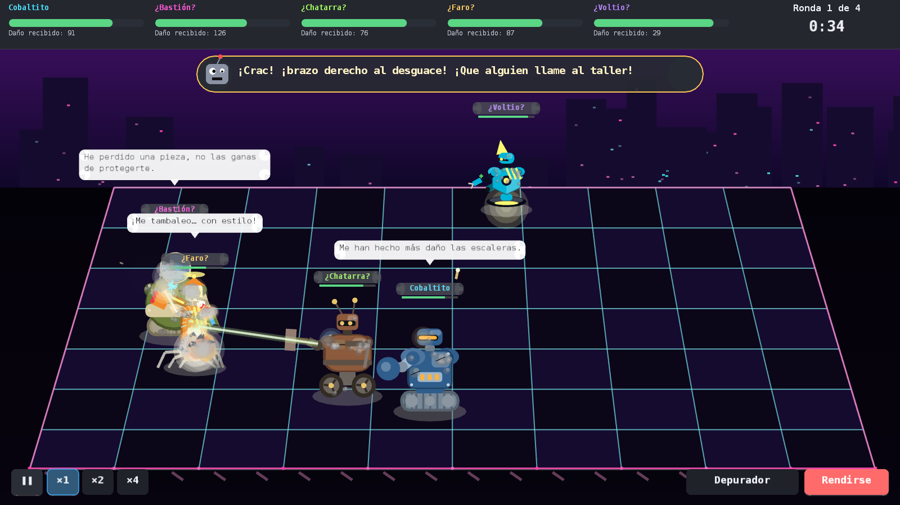

# MetajavBots

[](https://github.com/FrancisCode0o0/MetajavBots_next/actions/workflows/pruebas.yml)

**Español** · [Deutsch](#deutsch) · [English](#english)

Robots que se programan en Java y combaten por rondas, para aprender Java jugando: de cero absoluto a nivel avanzado. Al estilo de Robocode, con robots de diseño propio, cada uno con su personalidad, y un locutor robot loco que narra las peleas.




## Cómo se juega

1. **Instala un JDK 21 o más nuevo** (por ejemplo, [Eclipse Temurin](https://adoptium.net)). Hace falta un JDK, no solo un JRE: el juego compila tu código Java.
2. **Abre el juego**: `jugar.bat` en Windows, `./jugar.sh` en Linux y Mac. La primera vez, Gradle baja las bibliotecas.
3. Crea tu partida. Si nunca has programado, empiezas en **Noob I**; si no, una prueba corta te pone tu etiqueta.
4. Elige tu primer robot y ve al **Taller**: ahí está su código. Cámbialo, pulsa **Compilar** (Ctrl+S) y **¡a pelear!**
5. Una pelea son **cuatro rondas** de unos 40 segundos. Entre ronda y ronda se para: lees el informe, cambias el código y las piezas. **Gana quien haya recibido menos daño**; al final, el que pierde explota.

Tu robot es una clase de Java que hereda de `Metajavbot` (o `MetajavbotDe` en alemán, `MetajavbotEn` en inglés):

```java
public class MiRobot extends Metajavbot {
    @Override
    public void cadaTurno() {
        if (restanteAvance() == 0) {
            avanzar(120);
            girar(35);
        }
        apuntar(12);
    }

    @Override
    public void alVerEnemigo(Enemigo e) {
        apuntarHacia(e.angulo());
        atacar();
    }
}
```

**Qué hay**: 16 modelos de robot con su silueta y su personalidad; 236 piezas (armas láser, balas, misiles, cuerpo a cuerpo, lanzallamas, escudos, cabezas con radar y especiales, piernas, ruedas, orugas, alas, núcleos); 262 ejercicios que se comprueban solos (al estilo CodingBat y CodeStepByStep) y 70 lecciones en 22 temas de Java, de los primeros pasos a hilos, streams y diseño; 12 etiquetas (Noob, Junior y Senior I-IV) y una secreta; modo Historia con dos campañas largas con escenas ilustradas y dieciocho historias de combate; la computadora en cinco dificultades, adaptada a tu nivel; desafíos con modo azar, el desafío, battle royale, combate por equipos (con la computadora u otro jugador de compañero), máquina contra máquina (con la línea que se ejecuta a la vista), jefes por tema, tope de cálculo, depurador en vivo, laboratorio de pruebas, robots de otros jugadores y tu propio temario; estadísticas completas; todo en español, alemán e inglés.

**Cerebro de IA (opcional)**: el juego funciona entero sin IA. Si quieres, en *Ajustes › Cerebro de IA* puedes usar un modelo local con [KoboldCpp](https://github.com/LostRuins/koboldcpp) o uno en línea con tu propia clave (que se guarda fuera del juego). Con IA, los tutoriales son conversaciones, el código se revisa tras cada pelea y el temario se convierte en ejercicios. Más en [docs/CEREBRO.md](docs/CEREBRO.md).

## Cómo se hizo

MetajavBots lo he dirigido yo, Francis García Reyes, estudiante de Informática de primer semestre en la TH Mannheim; la mayor parte del código la han escrito modelos de IA bajo mi dirección. Mi trabajo:

- **Diseño y decisiones**: la idea, los modos de juego, el equilibrio, los textos, la música que quería y cada cambio, con sus prioridades.
- **Encargos**: cada función nueva empezó como un encargo escrito y corto (qué se necesita y cómo se comprueba que está bien), redactado conmigo por un chat de Claude que hacía de tutor.
- **Cadena de trabajo**: los encargos se ejecutaban uno tras otro, cada uno en su propia sesión, con scripts propios que lanzaban el siguiente, pausaban la cadena y avisaban de los permisos delicados.
- **Pruebas y depuración**: jugaba cada versión, buscaba los fallos y los convertía en nuevos encargos.
- **Revisión cruzada**: el trabajo de un modelo lo revisaba otro antes de darlo por bueno.

**Herramientas**: Claude Code (Claude Opus y Fable), Google Antigravity (Gemini), OpenCode y GitHub Copilot; Gradle, libGDX, Checkstyle y GitHub Actions.

**Reglas de calidad**: un commit solo con `gradlew compileJava estilo pruebas:prueba` en verde (Checkstyle sin avisos y más de 300 pruebas sin ventana), que [GitHub Actions](.github/workflows/pruebas.yml) repite en cada push; capturas de cada pantalla con letra normal y grande en los tres idiomas, revisadas antes de cerrar cada encargo. Los encargos y los informes de los modelos están en [docs/proceso/](docs/proceso/).

## Cómo citarlo

MetajavBots es de **Francis García Reyes**. El código tiene licencia [Apache-2.0](LICENSE) (conserva el aviso de [NOTICE](NOTICE)); los textos, ejercicios, tutoriales, diálogos y el arte, [CC BY 4.0](docs/LICENCIA_CONTENIDO.md). Si lo usas, cítalo así:

> García Reyes, Francis (2026). *MetajavBots: aprender Java programando robots que combaten.* https://github.com/ (enlace del repositorio)

---

## Deutsch

Roboter, die in Java programmiert werden und in Runden kämpfen – um Java spielend zu lernen: von null bis Fortgeschritten. Im Stil von Robocode, mit eigenen Roboter-Designs, jeder mit seiner Persönlichkeit, und einem verrückten Roboter-Ansager.

**So wird gespielt**

1. **Installiere ein JDK 21 oder neuer** (z. B. [Eclipse Temurin](https://adoptium.net)). Ein JRE reicht nicht: Das Spiel kompiliert deinen Java-Code.
2. **Starte das Spiel**: `jugar.bat` unter Windows, `./jugar.sh` unter Linux und Mac.
3. Lege dein Spiel an. Wer noch nie programmiert hat, beginnt bei **Noob I**; sonst stuft dich ein kurzer Test ein.
4. Wähle deinen ersten Roboter und geh in die **Werkstatt**: Dort ist sein Code. Ändere ihn, drück **Kompilieren** (Strg+S) und **ab in den Kampf!**
5. Ein Kampf hat **vier Runden** zu je etwa 40 Sekunden. Zwischen den Runden kannst du Code und Teile ändern. **Es gewinnt, wer weniger Schaden eingesteckt hat**; am Ende explodiert der Verlierer.

Dein Roboter ist eine Java-Klasse, die von `MetajavbotDe` erbt (Methoden auf Deutsch: `jedenZug()`, `beiSicht(Gegner g)`, `vorwaerts(…)`, `drehen(…)`, `zielenNach(…)`, `angreifen()`).

**Wie es entstanden ist**

MetajavBots habe ich, Francis García Reyes, Informatikstudent im ersten Semester an der TH Mannheim, geleitet; den größten Teil des Codes haben KI-Modelle unter meiner Anleitung geschrieben. Meine Arbeit:

- **Design und Entscheidungen**: die Idee, die Spielmodi, das Balancing, die Texte, die gewünschte Musik und jede Änderung mit ihrer Priorität.
- **Aufträge**: Jede neue Funktion begann als kurzer schriftlicher Auftrag (was gebraucht wird und wie man prüft, dass es stimmt), den ich mit einem Claude-Chat als Tutor formuliert habe.
- **Arbeitskette**: Die Aufträge liefen nacheinander, jeder in einer eigenen Sitzung, mit eigenen Skripten, die den nächsten starteten, die Kette pausierten und bei heiklen Berechtigungen warnten.
- **Testen und Debugging**: Ich habe jede Version gespielt, Fehler gesucht und daraus neue Aufträge gemacht.
- **Gegenseitige Prüfung**: Die Arbeit eines Modells hat ein anderes geprüft, bevor sie übernommen wurde.

**Werkzeuge**: Claude Code (Claude Opus und Fable), Google Antigravity (Gemini), OpenCode und GitHub Copilot; Gradle, libGDX, Checkstyle und GitHub Actions.

**Qualitätsregeln**: Ein Commit nur mit `gradlew compileJava estilo pruebas:prueba` im grünen Bereich (Checkstyle ohne Warnungen und über 300 Tests ohne Fenster), was [GitHub Actions](.github/workflows/pruebas.yml) bei jedem Push wiederholt; Screenshots jedes Bildschirms in normaler und großer Schrift in allen drei Sprachen, geprüft vor dem Abschluss jedes Auftrags. Die Aufträge und die Berichte der Modelle liegen in [docs/proceso/](docs/proceso/).

**Zitieren**: MetajavBots ist von **Francis García Reyes**. Code unter [Apache-2.0](LICENSE) (mit dem Hinweis aus [NOTICE](NOTICE)); Texte, Übungen, Tutorials, Dialoge und Grafik unter [CC BY 4.0](docs/LICENCIA_CONTENIDO.md).

> García Reyes, Francis (2026). *MetajavBots: Java lernen mit programmierten Kampfrobotern.*

---

## English

Robots you program in Java that fight in rounds – to learn Java by playing: from absolute zero to advanced. In the spirit of Robocode, with original robot designs, each with its own personality, and a crazy robot announcer.

**How to play**

1. **Install a JDK 21 or newer** (e.g. [Eclipse Temurin](https://adoptium.net)). A JRE is not enough: the game compiles your Java code.
2. **Start the game**: `jugar.bat` on Windows, `./jugar.sh` on Linux and Mac.
3. Create your game. If you have never programmed, you start at **Noob I**; otherwise a short test places you.
4. Choose your first robot and go to the **Workshop**: its code is there. Change it, press **Compile** (Ctrl+S) and **fight!**
5. A fight has **four rounds** of about 40 seconds. Between rounds you can change the code and the parts. **Whoever took less damage wins**; at the end, the loser explodes.

Your robot is a Java class extending `MetajavbotEn` (English methods: `onTick()`, `onSeeEnemy(Enemy e)`, `ahead(…)`, `turn(…)`, `aimTo(…)`, `attack()`).

**How it was made**

MetajavBots was directed by me, Francis García Reyes, a first-semester computer science student at TH Mannheim; most of the code was written by AI models under my direction. My part:

- **Design and decisions**: the idea, the game modes, the balance, the texts, the music I wanted, and every change with its priority.
- **Work orders**: every new feature started as a short written work order (what is needed and how to check it works), drafted with me by a Claude chat acting as a tutor.
- **Work chain**: the orders ran one after another, each in its own session, with my own scripts that launched the next one, paused the chain, and flagged sensitive permissions.
- **Testing and debugging**: I played every version, hunted bugs, and turned them into new work orders.
- **Cross-review**: one model's work was reviewed by another before it was accepted.

**Tools**: Claude Code (Claude Opus and Fable), Google Antigravity (Gemini), OpenCode, and GitHub Copilot; Gradle, libGDX, Checkstyle, and GitHub Actions.

**Quality rules**: a commit only with `gradlew compileJava estilo pruebas:prueba` green (Checkstyle with no warnings and 300+ headless tests), which [GitHub Actions](.github/workflows/pruebas.yml) repeats on every push; screenshots of every screen at normal and large font size in all three languages, reviewed before closing each work order. The work orders and the models' reports are in [docs/proceso/](docs/proceso/).

**How to cite**: MetajavBots is by **Francis García Reyes**. Code under [Apache-2.0](LICENSE) (keep the [NOTICE](NOTICE)); texts, exercises, tutorials, dialogues and art under [CC BY 4.0](docs/LICENCIA_CONTENIDO.md).

> García Reyes, Francis (2026). *MetajavBots: learning Java by programming fighting robots.*
